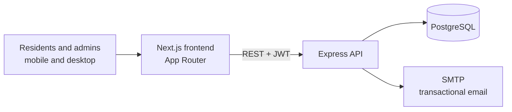

# Pio Brasileiro

**The meal and guest-room booking system for the Pontifical Brazilian College in Rome**, used day to day by its residents and staff.

Residents book lunch and dinner, bring guests, and request rooms. Admins plan the kitchen, run the guest house, manage users and send announcements by email. I built the whole thing: this Next.js frontend and its [Node.js + PostgreSQL backend](https://github.com/gabrielcoffee/piobrasileiro-backend).

**Live:** [piobrasileiroapp.com](https://piobrasileiroapp.com) (sign-in required)


## What it does

**For residents**
- Book lunch and dinner for each day of the week, at the college or to take away, with a booking deadline.
- Add guests to a meal.
- Request a room in the guest house for visitors.
- Manage their profile, photo and password, and get notified before deadlines.

**For admins**
- A meal calendar and booking overview for planning the kitchen.
- A full guest house workflow: incoming requests, reservations, validation, rooms and guests.
- User management with roles.
- Announcements: pick an email type, choose recipients, preview the rendered email, send, and review the send history per recipient.

## Architecture



- **Route groups for access control.** `(protected)` holds the resident pages and `admin/(admin-protected)` the admin pages. Each group's layout redirects anyone without a session or the right role.
- **JWT auth with role-based access** on the API, bcrypt password hashing, and email verification and password reset over SMTP.
- **Mobile first.** Most residents book from their phones, so admin pages have dedicated mobile layouts too.
- **A small in-house component library** (tables with search, modals, inputs, cards) on CSS Modules and global design tokens, instead of a UI framework.

## Stack

| | |
|---|---|
| Frontend | Next.js 15 (App Router), React 19, TypeScript, CSS Modules, Lucide icons |
| Backend | Node.js, Express, PostgreSQL, JWT, bcrypt, SMTP email ([repo](https://github.com/gabrielcoffee/piobrasileiro-backend)) |

## Project structure

```
src/
├── app/
│   ├── (protected)/              # resident pages: home, meals, guest house, profile
│   └── admin/(admin-protected)/  # admin: calendar, meals, reservations, rooms, users, announcements
├── components/                   # shared UI and feature components
├── contexts/                     # auth session and toasts
└── lib/                          # utilities
```

## Run locally

Start the [backend](https://github.com/gabrielcoffee/piobrasileiro-backend) first, then:

```bash
npm install
echo "NEXT_PUBLIC_API_URL=http://localhost:3003" > .env.local
npm run dev     # http://localhost:3000
```

Changes are tracked in [CHANGELOG.md](CHANGELOG.md).
